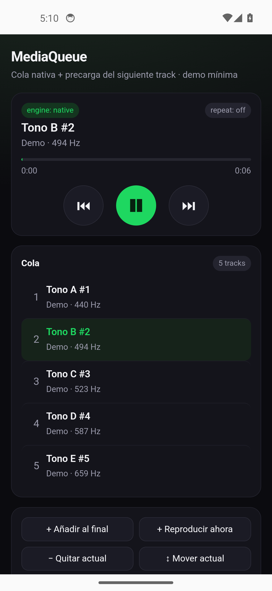

# capacitor-media-queue

**Continuous background audio** for web apps turned into installable apps: the queue
is owned by the native engine (Media3/ExoPlayer on Android, `AVQueuePlayer` on iOS),
not by JavaScript. With the screen locked and the device in Doze, the next track still
starts.

- Android verified on an emulator with **the screen off + Doze forced**: 5-track
  playlist played through, transitions with **1–8 ms** drift.
- Web engine fallback (Media Session API + two preloaded `<audio>` elements) for the
  browser and for the Google AI Studio preview.
- **MIT** license. Dependencies: Media3 (Apache-2.0), Capacitor (MIT).

> Spanish versions: [`README.md`](README.md) and [`docs/`](docs/). This file and
> `docs/en/` are the English translations; the Spanish originals are kept unchanged.

```
/android   Kotlin module (Media3 + MediaSessionService + preload + retries)
/ios       Swift module (AVQueuePlayer + Now Playing + interruptions)
/src       unified TypeScript bridge (no runtime dependencies)
/web       PWA fallback (Media Session + Service Worker + Wake Lock)
/example   Capacitor demo app (5 tracks, minimal UI, event log)
/docs      research, decisions, architecture, limits, testing, integration
/test      25 tests (node --test) over the queue, web engine and native bridge
```



## Installation

```bash
npm i capacitor-media-queue
npx cap sync
```

- **Android**: nothing else. The plugin manifest declares the permissions and the
  `MediaSessionService`; Gradle merges it.
- **iOS**: add `audio` to `UIBackgroundModes` in `Info.plist` and enable *Background
  Modes → Audio* in Xcode.
- **Web**: import `dist/esm/index.js`. Without a Capacitor runtime it uses the web
  engine.

## Usage

```js
import { createMediaQueue } from 'capacitor-media-queue';

const queue = createMediaQueue();   // native if present, web otherwise

await queue.setQueue([
  { id: 'a', url: 'https://cdn/a.mp3', title: 'A', artist: 'X', artwork: 'https://cdn/a.jpg' },
  { id: 'b', url: 'https://cdn/b.mp3', title: 'B', artist: 'X' },
], { startIndex: 0, autoplay: true });

await queue.addListener('trackChanged', (e) => {
  console.log(e.index, e.track?.title, e.automatic ? '(auto)' : '(user)');
});
await queue.addListener('error', (e) => console.warn(e.code, e.fatal, e.retries));
```

### API

| Method | Description |
|---|---|
| `setQueue(tracks, { startIndex, startPosition, autoplay, headers })` | Hands the whole queue to the engine (once) |
| `addToQueue(track)` / `insertAfterCurrent(track)` / `insertAt(track, i)` | Dynamic queue |
| `removeAt(i)` / `move(from, to)` | Reorder without interrupting playback |
| `play()` / `pause()` / `next()` / `prev()` / `seekTo(s)` / `stop()` | Transport |
| `setRepeatMode('off'\|'track'\|'queue')` / `setVolume(0..1)` / `setPlaybackRate(r)` | Modes |
| `getState()` / `getQueue()` | Current truth (useful when returning to the foreground) |
| `requestNotificationPermission()` | `POST_NOTIFICATIONS` (Android 13+) |
| `addListener(event, cb)` | `trackChanged`, `stateChanged`, `queueChanged`, `error`, `progress` |

Types: `Track`, `PlaybackState`, `TrackChangedEvent`, `QueueErrorEvent`.

## How it works (the part that matters)

```
JS: setQueue([...])  ──────────────►  native engine owns the queue
                                          │
                     TrackPreloader ──────┤ preloads the next track into cache
                                          │
                     end of track (audio clock, NOT a JS timer)
                                          ▼
                              the engine moves to the next item
                                          │
                     trackChanged event ──┘ (UI only)
```

Why this fixes the symptom: the next track is already in `SimpleCache` (Android) or is
already an `AVPlayerItem` in `readyToPlay` state (iOS) **before** the current one ends,
and the switch is performed by the media engine inside a foreground service (Android)
or with an active `playback` session (iOS). No JavaScript `ended`, no `setTimeout` and
no wake lock takes part in the transition.

## Platform configuration

**Android** (`AndroidManifest.xml`, already included in the module):

```xml
<uses-permission android:name="android.permission.FOREGROUND_SERVICE"/>
<uses-permission android:name="android.permission.FOREGROUND_SERVICE_MEDIA_PLAYBACK"/>
<uses-permission android:name="android.permission.WAKE_LOCK"/>
<uses-permission android:name="android.permission.POST_NOTIFICATIONS"/>

<service android:name="com.hermes.mediaqueue.PlaybackService"
         android:exported="true"
         android:foregroundServiceType="mediaPlayback">
  <intent-filter><action android:name="androidx.media3.session.MediaSessionService"/></intent-filter>
</service>
```

**iOS** (`Info.plist`):

```xml
<key>UIBackgroundModes</key>
<array><string>audio</string></array>
```

## Documentation

English (this set):

| Document | Content |
|---|---|
| [`docs/en/RESEARCH.md`](docs/en/RESEARCH.md) | Root causes (Doze, background limits, `AVAudioSession`), existing solutions with licenses, verdict |
| [`docs/en/DECISION.md`](docs/en/DECISION.md) | Why Capacitor + our own plugin, what is reused and what was written |
| [`docs/en/ARCHITECTURE.md`](docs/en/ARCHITECTURE.md) | Layers, data contract, queue and state diagrams |
| [`docs/en/INTEGRATION.md`](docs/en/INTEGRATION.md) | Integration into a Google AI Studio app, step by step, with a diff |
| [`docs/en/LIMITATIONS.md`](docs/en/LIMITATIONS.md) | Android/iOS/web differences, what cannot be done and why |
| [`docs/en/TESTING.md`](docs/en/TESTING.md) | What was actually verified, with commands and output |
| [`docs/en/SOURCES.md`](docs/en/SOURCES.md) | Sources and licenses |

Spanish originals: same names under [`docs/`](docs/).

## Demo

```bash
npm run build:example            # tsc + copy into example/www/vendor
cd example && npm i
npx cap add android && npx cap sync
cd android && ./gradlew assembleDebug
```

The demo uses five 6 s WAV files generated in `example/www/audio`. On Android it reads
`http://10.0.2.2:8099/` (serve that folder with `python3 -m http.server 8099`); in a
browser it uses `./audio/`. Parameters: `?base=`, `?autoplay=1`, `?tracks=N`.

English UI: `example/www/index.en.html` (the Spanish `index.html` stays the default).

Web fallback: serve the repo root and open `/web/` — `web/index.en.html` for the English
UI.

## Compatibility

| | Version |
|---|---|
| Capacitor | 7.x (compileSdk 35, CocoaPods) and 8.x (compileSdk 36, SPM) |
| Media3 | 1.8.0 (tested); 1.9+ requires compileSdk 36 |
| Android | minSdk 23 (plugin) / 24+ recommended; tested on API 34 |
| iOS | 14+ |
| Node (dev) | 20+ |

## License

MIT — see [`LICENSE`](LICENSE).
