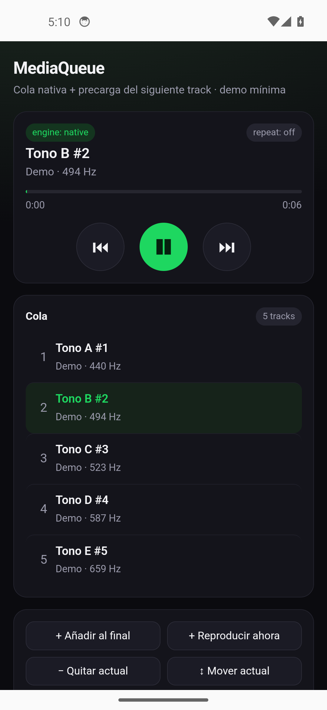

# capacitor-media-queue

Reproducción de audio **continua en background** para apps web convertidas en app
instalable: la cola la posee el motor nativo (Media3/ExoPlayer en Android,
`AVQueuePlayer` en iOS), no JavaScript. Con la pantalla bloqueada y el dispositivo
en Doze, el siguiente track arranca igual.

- Android verificado en emulador con **pantalla apagada + Doze forzado**:
  playlist de 5 tracks completa, transiciones con **1–8 ms** de deriva.
- Motor web de respaldo (Media Session API + doble `<audio>` precargado) para
  navegador y para el preview de Google AI Studio.
- Licencia **MIT**. Dependencias: Media3 (Apache-2.0), Capacitor (MIT).

```
/android   módulo Kotlin (Media3 + MediaSessionService + precarga + reintentos)
/ios       módulo Swift (AVQueuePlayer + Now Playing + interrupciones)
/src       puente TypeScript unificado (sin dependencias en runtime)
/web       fallback PWA (Media Session + Service Worker + Wake Lock)
/example   app demo Capacitor (5 tracks, UI mínima, logs de eventos)
/docs      investigación, decisiones, arquitectura, límites, pruebas, integración
/test      25 tests (node --test) sobre cola, motor web y puente nativo
```



## Instalación

```bash
npm i capacitor-media-queue
npx cap sync
```

- **Android**: nada más. El manifest del plugin declara permisos y el
  `MediaSessionService`; Gradle lo fusiona.
- **iOS**: añade `audio` a `UIBackgroundModes` en `Info.plist` y activa *Background
  Modes → Audio* en Xcode.
- **Web**: importa `dist/esm/index.js`. Si no hay runtime Capacitor, usa el motor web.

## Uso

```js
import { createMediaQueue } from 'capacitor-media-queue';

const queue = createMediaQueue();   // nativo si existe, web si no

await queue.setQueue([
  { id: 'a', url: 'https://cdn/a.mp3', title: 'A', artist: 'X', artwork: 'https://cdn/a.jpg' },
  { id: 'b', url: 'https://cdn/b.mp3', title: 'B', artist: 'X' },
], { startIndex: 0, autoplay: true });

await queue.addListener('trackChanged', (e) => {
  console.log(e.index, e.track?.title, e.automatic ? '(auto)' : '(usuario)');
});
await queue.addListener('error', (e) => console.warn(e.code, e.fatal, e.retries));
```

### API

| Método | Descripción |
|---|---|
| `setQueue(tracks, { startIndex, startPosition, autoplay, headers })` | Entrega la cola completa al motor (una sola vez) |
| `addToQueue(track)` / `insertAfterCurrent(track)` / `insertAt(track, i)` | Cola dinámica |
| `removeAt(i)` / `move(from, to)` | Reordenar sin cortar la reproducción |
| `play()` / `pause()` / `next()` / `prev()` / `seekTo(s)` / `stop()` | Transporte |
| `setRepeatMode('off'\|'track'\|'queue')` / `setVolume(0..1)` / `setPlaybackRate(r)` | Modos |
| `getState()` / `getQueue()` | Verdad actual (útil al volver a primer plano) |
| `requestNotificationPermission()` | `POST_NOTIFICATIONS` (Android 13+) |
| `addListener(evento, cb)` | `trackChanged`, `stateChanged`, `queueChanged`, `error`, `progress` |

Tipos: `Track`, `PlaybackState`, `TrackChangedEvent`, `QueueErrorEvent`.

## Cómo funciona (la parte que importa)

```
JS: setQueue([...])  ──────────────►  motor nativo dueño de la cola
                                          │
                     TrackPreloader ──────┤ precarga el siguiente track en caché
                                          │
                     fin del track (reloj de audio, NO un timer de JS)
                                          ▼
                              el motor pasa al siguiente item
                                          │
                     evento trackChanged ─┘ (solo para la UI)
```

Por qué esto arregla el síntoma: el track siguiente ya está en `SimpleCache` (Android)
o ya es un `AVPlayerItem` en estado `readyToPlay` (iOS) **antes** de que termine el
actual, y el cambio lo ejecuta el motor de medios dentro de un foreground service
(Android) o con una sesión `playback` activa (iOS). Ningún `ended` de JavaScript, ni
`setTimeout`, ni wake lock participa en la transición.

## Configuración de plataforma

**Android** (`AndroidManifest.xml`, ya incluido en el módulo):

```xml
<uses-permission android:name="android.permission.FOREGROUND_SERVICE"/>
<uses-permission android:name="android.permission.FOREGROUND_SERVICE_MEDIA_PLAYBACK"/>
<uses-permission android:name="android.permission.WAKE_LOCK"/>
<uses-permission android:name="android.permission.POST_NOTIFICATIONS"/>

<service android:name="com.hermes.mediaqueue.PlaybackService"
         android:exported="true"
         android:foregroundServiceType="mediaPlayback">
  <intent-filter><action android:name="androidx.media3.session.MediaSessionService"/></intent-filter>
</service>
```

**iOS** (`Info.plist`):

```xml
<key>UIBackgroundModes</key>
<array><string>audio</string></array>
```

## Documentación

| Documento | Contenido |
|---|---|
| [`docs/RESEARCH.md`](docs/RESEARCH.md) | Causas raíz (Doze, background limits, `AVAudioSession`), soluciones existentes con licencia, veredicto |
| [`docs/DECISION.md`](docs/DECISION.md) | Por qué Capacitor + plugin propio, qué se reutiliza y qué se escribió |
| [`docs/ARCHITECTURE.md`](docs/ARCHITECTURE.md) | Capas, contrato de datos, diagramas de cola y estados |
| [`docs/INTEGRATION.md`](docs/INTEGRATION.md) | Integración en una app de Google AI Studio, paso a paso, con diff |
| [`docs/LIMITATIONS.md`](docs/LIMITATIONS.md) | Diferencias Android/iOS/web, lo que no se puede y por qué |
| [`docs/TESTING.md`](docs/TESTING.md) | Qué se verificó de verdad, con comandos y salidas |
| [`docs/SOURCES.md`](docs/SOURCES.md) | Fuentes y licencias |

## Demo

```bash
npm run build:example            # tsc + copia a example/www/vendor
cd example && npm i
npx cap add android && npx cap sync
cd android && ./gradlew assembleDebug
```

El demo usa 5 WAV de 6 s generados en `example/www/audio`. En Android toma
`http://10.0.2.2:8099/` (sirve esa carpeta con `python3 -m http.server 8099`); en
navegador usa `./audio/`. Parámetros: `?base=`, `?autoplay=1`, `?tracks=N`.

Fallback web: sirve la raíz del repo y abre `/web/`.

## Compatibilidad

| | Versión |
|---|---|
| Capacitor | 7.x (compileSdk 35, CocoaPods) y 8.x (compileSdk 36, SPM) |
| Media3 | 1.8.0 (probado); 1.9+ requiere compileSdk 36 |
| Android | minSdk 23 (plugin) / 24+ recomendado; probado en API 34 |
| iOS | 14+ |
| Node (dev) | 20+ |

## Licencia

MIT — ver [`LICENSE`](LICENSE).
